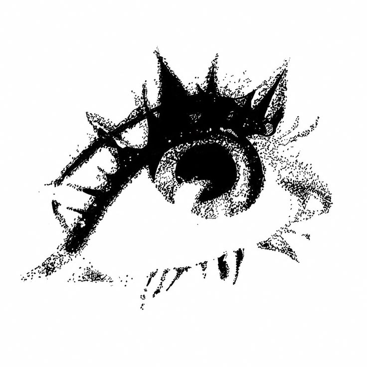
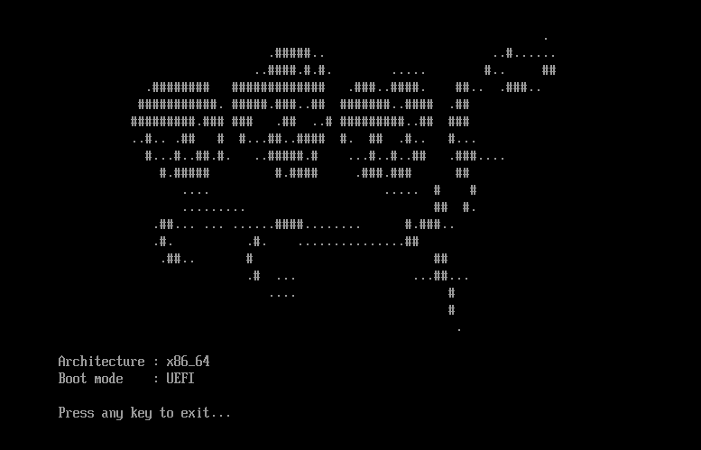

<div align="center">



# SyndromeOS

**A 64-bit bare-metal x86_64 operating system built from scratch.**

[](https://github.com/)
[](https://github.com/)
[](https://github.com/)

<br>



</div>

---

## Overview

**SyndromeOS** is a freestanding 64-bit operating system developed for the `x86_64` architecture. It initializes via a custom UEFI bootloader (`BOOTX64.EFI`).

## Features

- **UEFI  Bootloader:** Clean handoff via GNU-EFI.
- **Linear Framebuffer (GOP):** Custom font and color
- **Hardware Drivers:** Interval Timers and I/O ports
- **Reproducible Toolchain** 

## Quick Start

### Prerequisites
- **QEMU** with OVMF firmware (`winget install SoftwareFreedomConservancy.QEMU`, `apt install qemu-system-x86 ovmf`, or `brew install qemu`)
- **Docker** (recommended for cross-platform builds)

### Launch

| Platform | Build & Run | Fast Run (Skip Build) | Debug (GDB Stub) |
| :--- | :--- | :--- | :--- |
| **Windows** | `.\scripts\run.ps1` | `.\scripts\run.ps1 -SkipBuild` | `.\scripts\run.ps1 -EnableDebug` |
| **Linux / macOS** | `./scripts/run.sh` | `./scripts/run.sh --skip-build` | `./scripts/run.sh --debug` |
| **Make** | `make run` | `make run-fast` | `make debug` |


## Project Structure

```
SyndromeOS/
├── src/boot/        # UEFI bootloader, GOP graphics, fonts, and handoff
├── src/kernel/      # 64-bit kernel entry (kmain), PIT timer, and I/O
├── buildenv/        # Dockerized Ubuntu build environment
├── scripts/         # Automated cross-platform pipeline runners
└── Makefile         # Standard build and execution shortcuts
```
