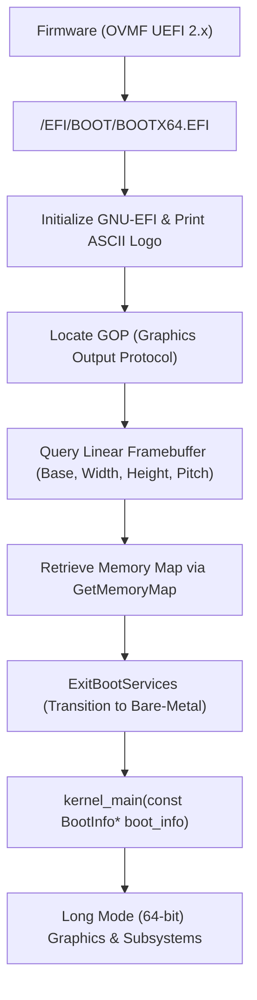

<p align="center">
  
</p>

<h1 align="center">SyndromeOS</h1>

<p align="center">
  <i>A 64-bit x86_64 operating system built from scratch.</i>
</p>

<p align="center">
  
  
  
  
</p>

<p align="center">
  <code>C</code> · <code>C++</code> · <code>Assembly</code> · <code>Rust</code> · <code>UEFI</code> · <code>CMake</code> · <code>QEMU</code>
</p>

<br>

<p align="center">
  <b>Low-level systems. Computer architecture. Graphics.</b>
</p>

<br>

<p align="center">
  
</p>

<p align="center">
  <i>SyndromeOS booting through UEFI on x86_64 with high-resolution GOP linear framebuffer.</i>
</p>

---

## About

**SyndromeOS** is a bare-metal operating system development project written from scratch for the `x86_64` architecture. It boots directly through UEFI firmware, initializes hardware through the Graphics Output Protocol (GOP), retrieves the physical memory map, transitions cleanly out of UEFI Boot Services, and jumps into a freestanding 64-bit Long Mode kernel.

The goal is to develop core OS subsystems from the ground up:
- Custom 64-bit UEFI bootloader (`BOOTX64.EFI`)
- Linear framebuffer graphics rendering & font engines
- Programmable Interval Timer (PIT) & interrupt handling
- Physical & virtual memory managers
- Custom userspace applications and a graphics pipeline

<br>

## Tech Stack

* **Languages:** `C11`, `C++17`, `x86_64 Assembly`, `Rust`
* **Firmware:** UEFI 2.x via GNU-EFI
* **Virtualization & Emulation:** QEMU (`qemu-system-x86_64`) + OVMF (Open Virtual Machine Firmware)
* **Build Systems:** CMake (>= 3.20), Docker containerized toolchain, Native Linux toolchain

<br>

## Quick Start (How to Run on Any Device)

SyndromeOS includes automated runners that detect your virtualization environment, build the OS, create a bootable FAT32 disk image, and launch QEMU.

### 🪟 Windows

1. Ensure **QEMU** is installed:
   ```powershell
   winget install SoftwareFreedomConservancy.QEMU
   ```
2. Run the pipeline (PowerShell):
   ```powershell
   .\scripts\run.ps1
   # or
   make run
   ```

### 🐧 Linux (Ubuntu / Debian / Fedora / Arch)

1. Make sure `qemu` and `ovmf` are installed:
   ```bash
   # Ubuntu / Debian
   sudo apt install qemu-system-x86 ovmf

   # Fedora
   sudo dnf install qemu-system-x86 edk2-ovmf

   # Arch Linux
   sudo pacman -S qemu-system-x86 edk2-ovmf
   ```
2. Run the pipeline:
   ```bash
   ./scripts/run.sh
   # or
   make run
   ```

### 🍎 macOS

1. Install QEMU via Homebrew:
   ```bash
   brew install qemu
   ```
2. Run the pipeline:
   ```bash
   ./scripts/run.sh
   # or
   make run
   ```

---

## Runner Options & Flags

Both `scripts/run.ps1` (Windows) and `scripts/run.sh` (Linux/macOS) support identical command-line flags:

| Flag (PowerShell) | Flag (Bash) | Description |
| :--- | :--- | :--- |
| `.\scripts\run.ps1` | `./scripts/run.sh` | Full pipeline: compile OS, format FAT32 image, boot QEMU |
| `.\scripts\run.ps1 -SkipBuild` | `./scripts/run.sh --skip-build` | Fast boot: skip compilation and launch current disk image |
| `.\scripts\run.ps1 -EnableDebug` | `./scripts/run.sh --debug` | GDB stub enabled on `localhost:1234` (-s -S) with serial to stdio |
| *N/A* | `./scripts/run.sh --native` | Force native build on Linux without Docker |

---

## Build Methods

### Option A: Containerized Build (Recommended, Cross-Platform)
By default, the runner automatically builds and uses the Docker container (`syndromeos-build`) defined in `buildenv/Dockerfile`. This ensures identical compiler versions, header locations, and GNU-EFI libraries across all platforms without polluting your host system.

Requirements:
- [Docker Desktop](https://www.docker.com/products/docker-desktop/) (Windows/macOS) or Docker Engine (`docker.io` on Linux).

### Option B: Native Linux Build
If you prefer building directly on Linux without Docker:
```bash
# 1. Install prerequisites (Ubuntu/Debian)
sudo apt install build-essential cmake gnu-efi ovmf dosfstools mtools qemu-system-x86

# 2. Build and run
./scripts/run.sh --native
```

---

## Boot Architecture & Execution Flow



1. **UEFI Entry (`src/boot/uefi/entry.cpp`):**
   Firmware loads `BOOTX64.EFI` from the FAT32 partition. Initializes UEFI system tables and outputs early diagnostic information.
2. **Graphics Output Protocol (GOP):**
   Queries the linear framebuffer base address, dimensions, and scanline pitch from the firmware.
3. **Boot Services Handoff:**
   Retrieves UEFI memory map descriptor and executes `ExitBootServices`, shutting down firmware runtime and handing control to the OS.
4. **Kernel Long Mode Entry (`src/kernel/kmain.cpp`):**
   Receives `BootInfo` structure containing the linear framebuffer pointer, paints the display, and halts on interrupt.

---

## Debugging with GDB

To debug kernel execution line-by-line:

1. Launch QEMU in debug mode:
   ```bash
   # Linux / macOS
   ./scripts/run.sh --debug

   # Windows
   .\scripts\run.ps1 -EnableDebug
   ```
2. In a separate terminal, connect with GDB:
   ```bash
   gdb build/SyndromeOS.so \
     -ex "target remote localhost:1234" \
     -ex "b efi_main" \
     -ex "c"
   ```

---

## Directory Structure

```
SyndromeOS/
├── .github/workflows/       # GitHub Actions automated CI build & boot verification
├── .vscode/                 # VS Code IntelliSense and development tasks
├── Assets/                  # Project artwork, logos, and screenshots
├── buildenv/                # Docker container build environment
│   └── Dockerfile           # Ubuntu 24.04 toolchain with GNU-EFI & OVMF
├── src/
│   ├── boot/
│   │   ├── graphics/        # UEFI GOP logo, color palettes, fonts
│   │   └── uefi/            # UEFI entry point (entry.cpp), GOP setup, handoff
│   └── kernel/              # Freestanding 64-bit kernel (kmain, PIT, IO, bootinfo)
├── scripts/                 # Automated cross-platform build and runner scripts
│   ├── run.ps1              # Comprehensive Windows PowerShell runner
│   └── run.sh               # Comprehensive Linux/macOS POSIX Bash runner
├── CMakeLists.txt           # Modern CMake configuration for freestanding UEFI target
├── Makefile                 # Standard Make targets (make, make run, make debug, make clean)
└── README.md                # Documentation and architecture guide
```

---

## License

This project is licensed under personal and open development terms. See repository commits for history.